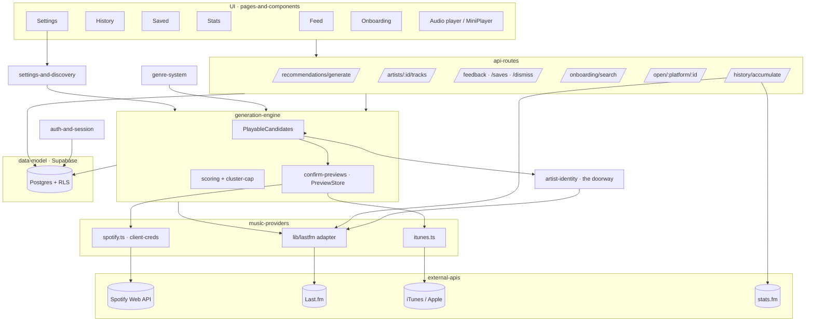

# flipside — Codebase Wiki

A cross-linked map of how flipside actually works, verified by reading the code on
2026-06-06 (module map refreshed 2026-10-24, #175). Pages link with Obsidian-style `[[wikilinks]]`. Start here, then follow
links into the subsystem you care about.

> **For agents/LLMs:** read this hub first, then the specific page for the area you're
> editing. Don't infer architecture from training priors — every claim here was read
> out of the code. If you change behavior, update the relevant page (and its
> `updated:` date).

## What flipside is

flipside is a **music-discovery app** (Next.js 16, App Router, React 19, Supabase).
You log in with **just a username** — there is no Spotify login. It builds one
personalized discovery surface, the **Feed** ("For You"): a scored, diversity-capped stack
of artist cards. Every batch is always "Wander farther": about half of it comes from outside
your usual genres (no setting). (Explore, the old rails page, was folded into Feed on 2026-11-10, #205;
`/explore` redirects to `/feed`.)

Recommendations are grown by walking the **Last.fm** artist-similarity graph from your
seeds, resolving candidate names to artists, scoring them by a "How famous?"
popularity curve, capping genre clustering for diversity, and confirming each artist
has a **playable 30-second preview** (iTunes first, Spotify fallback) before showing it.

## The map

## Pages

| Page | What it covers |
|---|---|
| [[architecture-overview]] | The big picture: route groups, request lifecycle, the generation flow end-to-end |
| [[auth-and-session]] | Username-only NextAuth, HMAC, JWT cookie, CSRF, middleware gate |
| [[data-model]] | Every Supabase table, columns, RLS, RPCs |
| [[generation-engine]] | The Feed pipeline: seeds → similarity → score → diversity → confirm → cache |
| [[music-providers]] | The Last.fm / Spotify / iTunes adapters, module layering, and the breakers/limiters around external calls |
| [[external-apis]] | Catalog of every external service: Spotify, Last.fm, iTunes, stats.fm — what each provides |
| [[api-routes]] | The HTTP surface: every route, auth, inputs, what it calls |
| [[pages-and-components]] | Screens, shared components, client hooks, playback + "open in platform" UX |
| [[genre-system]] | The 4-level genre tree, normalization, adjacency scoring, build scripts |
| [[settings-and-discovery]] | Discovery settings model (How famous? slider; Wander farther is always on) |
| [[infra-and-ops]] | next.config/CSP, middleware, cron, color extraction, scripts |
| [[spotify-dependency]] | **The analysis**: exactly what Spotify is used for and how replaceable it is |

## Module map (`lib/`)

| Module | What it owns |
|---|---|
| `recommendation/engine.ts` | Feed orchestration ([[generation-engine]]) |
| `recommendation/far-picks.ts` | the always-on far pool (ported from Explore's discovery rails) |
| `recommendation/playable-candidates.ts` | name → confirmed-playable pipeline (primary pool, bleed, far pool); `livePlayablePorts` |
| `recommendation/preview-store.ts` | `PreviewStore`, sole owner of `artist_tracks_cache` |
| `recommendation/exclusions.ts` | the one "never show this artist" policy |
| `lastfm/` | the one Last.fm adapter: key, timeouts, gate (`limit.ts`), `lastfm_cache` (`cache.ts`), counters |
| `music-provider/` | `itunes.ts` (previews, `itunesFetch`), `spotify.ts` (client-creds top-tracks + script search), shared types |
| `artist-identity/` | the doorway (`ArtistIdentity`), `artistNameKey`, Last.fm lookup (`lastfm-lookup.ts`), MusicBrainz (`musicbrainz.ts`) — ADR-0001 |
| `cards/` | server-side card assembly (`CardArtist`, `feed-cards.ts`) |
| `client/` | framework-free UI controllers (feed generation, artist signals) under thin hooks in `hooks/` |
| `history/` | Last.fm / stats.fm listening history → `ingestListens` |
| `metrics/api-call-counter.ts` | per-upstream live-call counters for `[gen-timing]` |
| `limiter.ts` | generic gate (`createLimiter`) behind the Last.fm and iTunes limiters |
| `cooldown.ts` | atomic per-user generation cooldown claim |
| `taste-change.ts` | taste-change invalidation policy (genre filter → unseen Feed wipe) |
| `external-links.ts` | `linkFor`: "Open in Apple Music" link resolution |

**Removed in #175:** the Spotify user-token surface (`/api/spotify/*`, history syncer,
like / save→playlist; tag `archive/spotify-user-token`), the `MusicProvider` interface,
`provider.ts` / `spotify-provider.ts`, `lastfm-search.ts`, `enrich-artist.ts`,
`history/name-utils.ts`, top-level `lastfm-cache.ts` / `lastfm-limit.ts` (now `lib/lastfm/`).

**Removed in #205 (2026-11-10):** the Explore page and everything only it used —
`app/(app)/explore`, `/api/explore/*`, `components/explore/`, the Explore `ArtistCard` /
`TrackStrip`, `ExplorePrewarm`, `explore-engine.ts`, `explore-rail-payloads.ts`,
`explore-input.ts`, the rail session (`client/rail-session.ts`, `hooks/use-rail-session.ts`),
`useArtistColor`, and the Settings `rebuild()`. Its two discovery rails became `far-picks.ts`.

## Sources

Raw research sweeps (with inline citations + confidence labels) live in `docs/_sweeps/`:
`research-A-deezer-apple.md`, `research-B-musicbrainz-lastfm.md`, `research-C-spotify-state.md`.
Historical design docs and PRDs are under `docs/superpowers/`.
